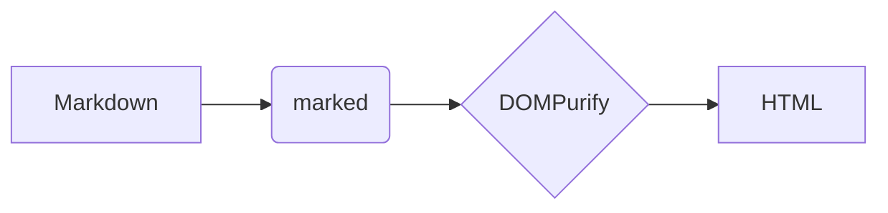

# Markdown Reader sample

A fixture that exercises every feature. **Bold**, *italic*, ~~strike~~, `inline code`
and a [link](https://example.com). Autolink: https://www.mozilla.org

## Lists

- Item one
- Item two
  - Nested item
- [x] Done task
- [ ] Open task

1. First
2. Second

## Table

| Feature   | Status | Notes         |
| --------- | :----: | ------------- |
| GFM       |   ✅   | tables, tasks |
| Highlight |   ✅   | highlight.js  |

## Code

```js
// Syntax highlighting
export function greet(name = "world") {
  return `Hello, ${name}!`;
}
```

```python
def fib(n: int) -> int:
    return n if n < 2 else fib(n - 1) + fib(n - 2)
```

```
plain block without a language
```

## Diagram



## Math

Inline $e^{i\pi} + 1 = 0$ and a block:

$$
\int_0^\infty e^{-x^2}\,dx = \frac{\sqrt{\pi}}{2}
$$

## Image

A relative image (blocked unless the server CSP is removed):


## Hostile HTML

None of this may run or survive sanitizing:

<script>document.title = "HACKED"; window.hacked = true;</script>

<a href="javascript:document.title='HACKED'">javascript link</a>

## Duplicate

### Duplicate

> Blockquote at the end, so the page is long enough to scroll.

---

Lorem ipsum dolor sit amet, consectetur adipiscing elit, sed do eiusmod tempor
incididunt ut labore et dolore magna aliqua.
